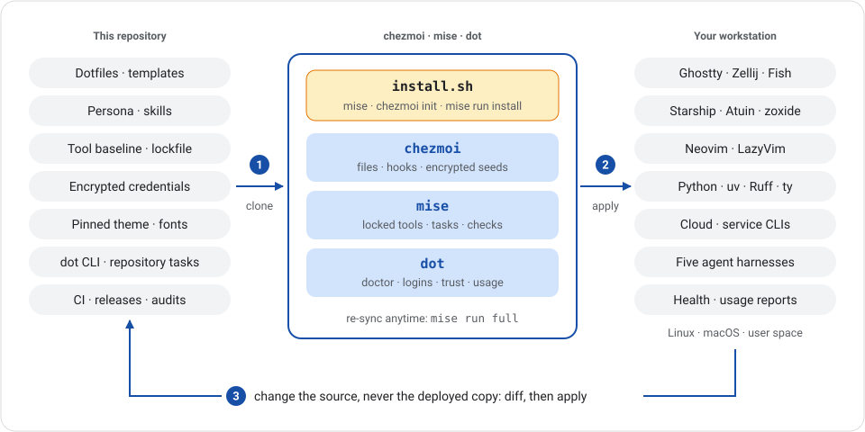
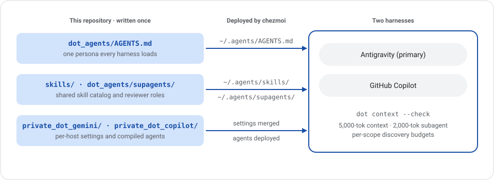

# Dot

Personal dotfiles for **AI-driven, CLI-first development** on Linux and macOS. [Chezmoi](https://www.chezmoi.io/) manages files; [mise](https://mise.jdx.dev/) manages tools and tasks. Read, borrow, or fork to build your own workstation.

[](https://github.com/fmind/dot/actions/workflows/ci.yml) [](https://github.com/fmind/dot/releases/latest) [](LICENSE)

[Install](#installation) · [Use](#everyday-use) · [Agents](#agent-layer) · [Credentials](#credentials) · [Adapt](#adapting-this)

<a href=".github/assets/dot-overview.svg">
  
</a>

## Highlights

- **Terminal:** Ghostty, Zellij, and Fish with Starship, Atuin, zoxide, fzf, yazi, and lazygit, tuned for keyboard speed and ultrawide layouts.
- **Editor:** Neovim (LazyVim), unified across tools with [fmind/theme](https://github.com/fmind/theme).
- **Agents:** Antigravity (`agy`, primary) and Copilot share one persona, [skill catalog](skills/), and read-only reviewer suite.
- **Development:** Python 3.14 with uv, Ruff, and ty plus cloud/service CLIs; projects pin their own stack tools.
- **Automation:** `dot` checks workstation health, manages multi-repo workspaces, handles provider logins and workspace trust, and enforces agent context budgets; `with-secret` scopes per-command keys.

## Prerequisites

| Platform            | Requirements                            | CI coverage                                  |
| ------------------- | --------------------------------------- | -------------------------------------------- |
| Linux x86-64        | glibc 2.39+ (Debian 13 / Ubuntu 24.04+) | All checks, tests, starter tests, and builds |
| Linux arm64         | glibc 2.39+ (Debian 13 / Ubuntu 24.04+) | Tool locks verified in CI; exercised locally |
| macOS Apple Silicon | macOS 15+, Xcode Command Line Tools     | Templates, Python, and starter tests         |

macOS follows [Homebrew's supported versions](https://docs.brew.sh/Installation#macos-requirements); other platforms are untested. CI validates locks, templates, code, and builds without running the host installer end-to-end.

Install host packages first; everything else runs in user space:

```bash
# Debian / Ubuntu
sudo apt install -y git curl libatomic1 build-essential gnome-keyring xclip wl-clipboard fonts-noto-color-emoji

# macOS
xcode-select --install
```

The installer requires mise 2026.11.9 or newer and installs it if absent. [Ghostty](https://ghostty.org/docs/install/binary) is the recommended terminal. Containers are optional: on macOS, mise installs Colima, Docker CLI, Compose, and Buildx (`colima start`); on Linux, install Docker Engine from your distribution.

## Installation

> [!WARNING]
> Personal dotfiles: [adapt them](#adapting-this) and back up existing files first. Setup overwrites managed targets without backups, agents run with autonomous permissions, and `chezmoi apply` auto-trusts your allowlisted GitHub repos under `~/fmind` (configured in `~/.config/dot.yaml`). Keep untrusted clones outside trusted folders and review [trust behavior](skills/dot-cli/references/daily-workflows.md#folder-trust) before use.

Inspect [`install.sh`](install.sh), then run:

```bash
git clone https://github.com/fmind/dot.git ~/.local/share/chezmoi
bash ~/.local/share/chezmoi/install.sh
```

Enter **your own** Git name, email, and personal-repo email at the prompts (defaults are mine), then open a new shell and run `dot doctor`.

On a fresh fork without personal `age` encryption or commit-signing keys, `dot doctor` exits `0` and prints `! ... MISSING` warnings under `Secrets & Encryption` until you configure them:

```text
Secrets & Encryption
  ! ~/.config/chezmoi/key.txt MISSING
  ! ~/.ssh/id_ed25519_signing MISSING
```

Rerun `install.sh` to resume setup (`SKIP_GIT_PULL=true` skips upstream fetch). On an initialized checkout, `mise run full` reapplies files and syncs locked tools, `dot`, and completions.

### Shell

Ghostty and Zellij launch Fish without changing your login shell. Fish attaches to Zellij once on local interactive terminals (skipping agent, IDE, CI, and SSH shells) and drops back to a plain shell on detach or exit. Elsewhere, run `fish` or set your terminal shell to `~/.local/share/mise/shims/fish`.

## Everyday use

```bash
dot --help                # List commands
dot doctor                # Check workstation health
dot doctor --headroom     # Check disk and memory before large jobs
dot context --check       # Check global and project context budgets
dot status --fetch        # Fetch remotes and show repo status
dot pull                  # Fast-forward clean repos
```

Edit sources in `~/.local/share/chezmoi`, then preview and apply:

```bash
cd ~/.local/share/chezmoi
mise run diff
mise run apply
```

See the [Dot CLI guide](skills/dot-cli/SKILL.md) for all commands and recovery workflows.

Keyboard ergonomics:

- **Fish abbreviations:** `a` Antigravity (`agy`), `g` git (`gl` lazygit), `m` mise (`mr` `mise run`), `v` Neovim, `y` yazi, and `h` `dot` (full list in [aliases.fish](dot_config/fish/conf.d/aliases.fish)).
- **Zellij:** `Alt a` `agy`, `Alt g` lazygit, `Alt y` yazi, `Alt /` sessions, `Alt n` new pane, and `Ctrl o` then `d` detach (full keymap in [config.kdl](dot_config/zellij/config.kdl)).
- **Neovim:** `<leader>gm` merge-base diff, `Tab` accept completion, and `Enter` newline (see [nvim](dot_config/nvim/lua/config/)).

### Dot configuration

Machine-local overrides live in unmanaged `~/.config/dot.yaml` and merge over [built-in defaults](dot/src/fmind_dot/config.py); select a `~/.config/dot.*.yaml` profile via `dot --config <path>` or `DOT_CONFIG_PATH`.

## Repository tasks

Run from the checkout (`mise tasks` lists all tasks and aliases):

| Command            | Purpose                                                                         |
| ------------------ | ------------------------------------------------------------------------------- |
| `mise run diff`    | Preview dotfile changes                                                         |
| `mise run apply`   | Apply files and eligible hooks                                                  |
| `mise run doctor`  | Check workstation health (`dot`, chezmoi, and mise)                             |
| `mise run full`    | Install locked repo and global tools, apply dotfiles, deploy `dot`, completions |
| `mise run upgrade` | Upgrade dependencies, tools, theme pin, and plugins (includes `full`)           |
| `mise run all`     | Check, test, and build the repository (read-only; no file rewrites or deploy)   |

Contributor guides: [AGENTS.md](AGENTS.md) and [releases & qualification](.agents/skills/dot-release/SKILL.md).

## Agent layer

<a href=".github/assets/agent-layer.svg">
  
</a>

Antigravity and Copilot share [`dot_agents/AGENTS.md`](dot_agents/AGENTS.md) and [`skills/`](skills/). Launching `agy` from Fish or Zellij (`Alt a`) prepends mise shims on `PATH` so commands resolve each project's tool pins.

Single-discipline `fmind-review-*` subagents ([`dot_agents/supagents/`](dot_agents/supagents/)) compile via [supagents](https://github.com/fmind/agent-supagents) across Antigravity and Copilot for independent read-only code, cloud/security, data/ML, docs, and visual reviews. Implementation tasks spawn each host's built-in subagents with the relevant skills instead of static roles; see [subagent](skills/subagent/SKILL.md) and [cross-harness agents](skills/agent-harnesses/references/cross-harness-agents.md).

## Agent skills

Setup links [`skills/`](skills/) into `~/.agents/skills/` beside standalone installs (restart open sessions after catalog updates). See [skill authoring (`skillify`)](skills/skillify/SKILL.md) and [catalog maintenance (`dot-skills`)](.agents/skills/dot-skills/SKILL.md).

Common slash commands (`agy -c` resumes a session; `/compact` shrinks active context):

- **Deliverables:** [`/humanize`](skills/humanize/SKILL.md) (clear prose), [`/draft`](skills/draft/SKILL.md) (Google Docs, Sheets, Slides, Gmail drafts, and Typst PDF/PPTX decks), and [`/clipboard`](skills/clipboard/SKILL.md) (copy last output)
- **Review & trimming:** [`/full-review`](skills/full-review/SKILL.md) (repo/PR audit, smoke tests, HTTP probing) and [`/subagent`](skills/subagent/SKILL.md) (adversarial reviewers)
- **Workflows & status:** [`/skillify`](skills/skillify/SKILL.md) (lesson capture, skill authoring, and token trimming) and [`/fmind`](skills/fmind/SKILL.md) (portfolio and daily news)

## Credentials

### Authentication & Logins

```bash
dot login                 # Reconcile configured providers (auth.login); opens browser only if needed
dot login --check         # Exit 1 if any configured provider needs login
dot login github          # GitHub
dot login workspace       # Google Workspace
dot login gcp             # Google Cloud and Application Default Credentials (ADC)
```

GitHub pushes over SSH even for HTTPS clones (add keys in [GitHub settings](https://github.com/settings/keys)), while HTTPS fetches reuse `gh` credentials. `dot login` reconciles default providers (`github`, `gcp`, `workspace`); see [authentication](skills/dot-cli/references/authentication.md) for OAuth setup and scopes.

Harnesses manage their own logins: run `agy` for Antigravity (self-updates) or `copilot login` for Copilot (locked by mise); see [agent harnesses](skills/agent-harnesses/SKILL.md). Add optional MCP servers via [mcp-setup](skills/agent-harnesses/references/mcp-setup.md).

### Commit signing

Each machine signs commits and annotated tags with a dedicated passphraseless Ed25519 key (`~/.ssh/id_ed25519_signing`) so agents commit unattended and keys revoke per host; machines without it commit unsigned. Provision once (replace `example.com` with your own domain; `dot login github` drops the temporary signing scope afterward):

```bash
ssh-keygen -t ed25519 -N '' -C "git-signing@example.com" -f ~/.ssh/id_ed25519_signing
dot login github --grant write:ssh_signing_key
gh ssh-key add ~/.ssh/id_ed25519_signing.pub --type signing --title "git signing $(date +%F)"
dot login github
printf '*@example.com namespaces="git" %s\n' "$(cat ~/.ssh/id_ed25519_signing.pub)" >>"$(chezmoi source-path)/dot_config/git/allowed_signers"
chezmoi apply ~/.gitconfig ~/.config/git/allowed_signers
```

Commit [`allowed_signers`](dot_config/git/allowed_signers) for local verification (`git log --show-signature`), then enable [vigilant mode](https://docs.github.com/en/authentication/managing-commit-signature-verification/displaying-verification-statuses-for-all-of-your-commits) in [GitHub keys](https://github.com/settings/keys). To retire a machine while preserving historical verification, append `valid-before="YYYYMMDD"` (`namespaces="git",valid-before="YYYYMMDD"`) and delete its GitHub key.

### Secret Management

Secrets are never exported at shell startup:

- **Native credential seeds:** Hugging Face credentials deploy only when absent so interactive logins persist across `apply`. Isolate client accounts via [customer overrides](skills/dot-cli/references/authentication.md#customer-overrides-and-isolation).
- **Scoped secrets:** inject a personal key from env or `0600`/`0400` `~/.config/dot/secrets/<NAME>` into one command via `with-secret` ([scoped credentials](skills/dot-cli/references/authentication.md#scoped-credentials)):

  ```sh
  with-secret OPENROUTER_MANAGEMENT_KEY -- <command>
  ```

- **Collector configs:** optional personal knowledge-collector ([Brain Framework](skills/bf/SKILL.md), `bf`) credentials under `~/.config/bf/credentials/` overwrite on apply; edit their encrypted `.age` sources only.
- **Encrypted sources:** `~/.config/chezmoi/key.txt` decrypts `*.age` files (apply skips them when absent). Back up the key, never copy it to customer machines, and manage `*.age` files via [chezmoi](.agents/skills/chezmoi/SKILL.md).

## Adapting this

Fork and replace personal defaults:

1. **Identity:** prompts in [`.chezmoi.toml.tmpl`](.chezmoi.toml.tmpl), clone URL in [`install.sh`](install.sh), and [`allowed_signers`](dot_config/git/allowed_signers) before [commit signing](#commit-signing). Put local Git overrides in unmanaged `~/.config/git/config.local`.
1. **Secrets:** replace the age recipient in [`.chezmoi.toml.tmpl`](.chezmoi.toml.tmpl) and remove or re-encrypt `*.age` files before applying ([Secret Management](#secret-management)).
1. **Persona:** edit [`dot_agents/AGENTS.md`](dot_agents/AGENTS.md).
1. **Workspaces & trust:** update `pull.directories`, `trust.github_owners`, and `trust.agy_projects` in `~/.config/dot.yaml`, `includeIf` paths in [`dot_gitconfig.tmpl`](dot_gitconfig.tmpl), and `BRAIN_LOCATION` in [`dot_config/mise/config.toml`](dot_config/mise/config.toml) and [`env.fish`](dot_config/fish/conf.d/env.fish) if you use `bf`. Matching Git repositories are trusted in Antigravity (see [the trust warning](#installation)); manage mise trust via `mise trust` or unmanaged `~/.config/mise/conf.d/trust.toml`.
1. **Theme & design:** point [`.chezmoiexternal.toml.tmpl`](.chezmoiexternal.toml.tmpl) at your own theme repo instead of [fmind/theme](https://github.com/fmind/theme), which provides app themes, `~/.agents/DESIGN.md`, and `~/.agents/themes/`. `mise run upgrade` advances this pin.

## Uninstall / rollback

> [!WARNING]
> `chezmoi purge` deletes `~/.local/share/chezmoi` (including uncommitted edits) and `~/.config/chezmoi/key.txt` (your `age` decryption key). `mise implode --config` removes `~/.local/share/mise` (including active Fish and Zellij binaries).

- **Uninstall:** no single uninstaller exists. Back up `~/.config/chezmoi/key.txt` and uncommitted edits, save `chezmoi managed`, and preview with `chezmoi purge --dry-run`. Then run `chezmoi purge`, switch to a system shell (`bash`/`zsh`) to run `mise implode --config`, and remove leftover deployed files, shell blocks, fonts, and agent state.
- **Roll back:** save local edits, check out the prior release tag, run `mise run full` followed by `mise run vim` to sync Neovim plugins, and verify with `mise run doctor` (newer files and app data remain).

## Security

Report vulnerabilities via [SECURITY.md](.github/SECURITY.md).

## License

[MIT](LICENSE) © Médéric Hurier (Fmind)
