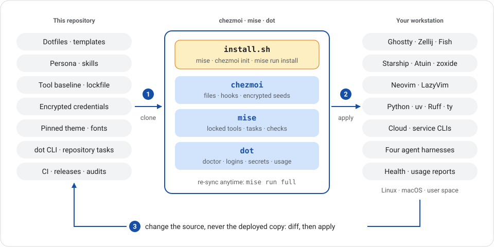
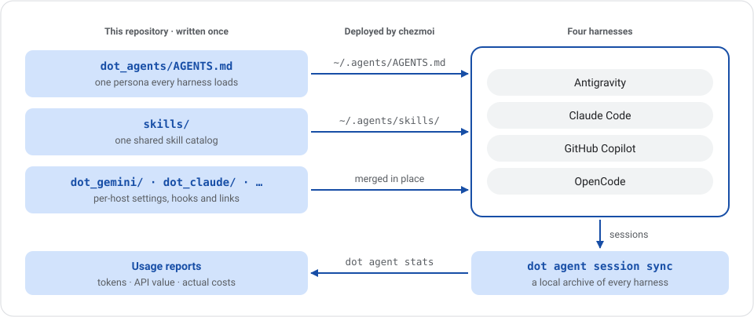

# Dot

Personal dotfiles for **AI-driven, CLI-first development** on Linux and macOS. [Chezmoi](https://www.chezmoi.io/) manages files; [mise](https://mise.jdx.dev/) manages tools and tasks. Read, borrow, or fork to build your own workstation.

[](https://github.com/fmind/dot/actions/workflows/ci.yml) [](https://github.com/fmind/dot/releases/latest) [](LICENSE)

[Install](#installation) · [Use](#everyday-use) · [Agents](#agent-layer) · [Credentials](#credentials) · [Adapt](#adapting-this)

<a href=".github/assets/dot-overview.svg">
  
</a>

## Highlights

- **Terminal:** Ghostty, Zellij, and Fish with Starship, Atuin, zoxide, fzf, yazi, and lazygit — tuned for keyboard speed and ultrawide layouts.
- **Editor:** Neovim (LazyVim), unified across tools with [fmind/theme](https://github.com/fmind/theme).
- **Agents:** Antigravity (primary), Claude Code, Copilot, OpenCode, and Pi share one persona and [skill catalog](skills/), with local session archiving and usage stats.
- **Development:** Python 3.14 with uv, Ruff, ty, and pytest plus cloud/service CLIs; projects pin their own stack tools.
- **Automation:** `dot` checks workstation health, manages multi-repo workspaces, handles provider logins and scoped secrets, and enforces agent context budgets.

## Prerequisites

| Platform            | Requirements                            | CI coverage                                  |
| ------------------- | --------------------------------------- | -------------------------------------------- |
| Linux x86-64        | glibc 2.39+ (Debian 13 / Ubuntu 24.04+) | Full repository gate and starter tests       |
| Linux arm64         | glibc 2.39+ (Debian 13 / Ubuntu 24.04+) | Tool locks verified in CI; exercised locally |
| macOS Apple Silicon | macOS 15+, Xcode Command Line Tools     | Templates, Python, and starter tests         |

macOS follows [Homebrew's supported versions](https://docs.brew.sh/Installation#macos-requirements); other platforms are untested. CI validates locks, templates, code, and builds without running the host installer end-to-end.

Install host packages first; everything else runs in user space:

```bash
# Debian / Ubuntu
sudo apt install -y git curl libatomic1 build-essential gnome-keyring xclip wl-clipboard fonts-noto-color-emoji

# macOS
xcode-select --install
```

The installer requires mise 2026.11.6 or newer and installs it if absent. [Ghostty](https://ghostty.org/docs/install/binary) is the recommended terminal. Containers are optional: on macOS, mise installs Colima, Docker CLI, Compose, and Buildx (`colima start`); on Linux, install Docker Engine from your distribution.

## Installation

> [!WARNING]
> Personal dotfiles: [adapt them](#adapting-this) and back up existing files first. Setup overwrites managed targets without backups. Agents run with autonomous permissions, and apply auto-trusts configured workspaces (Copilot inherits trust across subdirectories; keep untrusted clones outside `pull.directories`) and owner-allowlisted repos; review [trust behavior](skills/dot-cli/references/daily-workflows.md#folder-trust) before use.

Inspect [`install.sh`](install.sh), then run:

```bash
git clone https://github.com/fmind/dot.git ~/.local/share/chezmoi
bash ~/.local/share/chezmoi/install.sh
```

Enter **your own** Git name, email, and personal-repo email at the prompts (defaults are mine), then open a new shell and run `dot doctor`.

Rerun `install.sh` to resume setup (`SKIP_GIT_PULL=true` skips upstream fetch). On an initialized checkout, `mise run full` reapplies files and syncs locked tools, `dot`, and completions.

### Shell

Ghostty and Zellij launch Fish without changing your login shell. Fish attaches to Zellij once at startup and drops back to a plain shell on detach or exit. Elsewhere, run `fish` or set your terminal shell to `~/.local/share/mise/shims/fish`.

## Everyday use

```bash
dot --help                # List commands
dot doctor                # Check workstation health
dot doctor --headroom     # Check disk and memory before large jobs
dot config show           # Show effective settings
dot agent stats           # Report agent token and cost usage
dot status --fetch        # Fetch remotes and show repo status
dot orphan                # List unmanaged leftovers
```

Edit sources in `~/.local/share/chezmoi`, then preview and apply:

```bash
cd ~/.local/share/chezmoi
mise run diff
mise run apply
```

See the [Dot CLI guide](skills/dot-cli/SKILL.md) for all commands and recovery workflows.

Keyboard ergonomics:

- **Fish abbreviations:** `a` `agy` (`ac` continue, `ai` interactive, `ap` print), `g` git (`gl` lazygit), `m` mise (`mr` `mise run`), `v` Neovim, `y` yazi, `h` `dot` (`hd` doctor, `hh` headroom, `hs` fetched dirty status, `hp` pull, `ho` orphans, `hc` caches, `ha` agent stats).
- **Zellij:** `Alt a` Antigravity, `Alt g` lazygit, `Alt y` yazi, `Alt /` session manager, `Alt i` next attention, `Alt Shift i` attention inbox; `Alt n` tiles up to four ultrawide columns before half-stacking (`Ctrl b`, `Space`); detach with `Ctrl o`, `d`.
- **Neovim:** `<leader>gm` diffs buffer against default-branch merge-base, `Tab` accepts completions, `Enter` inserts newline, and `mise lsp` validates `mise.toml`.

### Dot configuration

Machine-local overrides live in unmanaged `~/.config/dot.yaml` and merge over [built-in defaults](dot/src/fmind_dot/config.py). Edit and validate with `dot config edit`, or select a `~/.config/dot.*.yaml` profile via `dot --config <path>` or `DOT_CONFIG_PATH`.

### Usage reports

`dot agent stats` reports tokens, estimated API value, and recorded provider spend (including archived Codex/Grok history; `--monthly` groups by UTC month) after syncing local transcripts via `dot agent session sync`; see [agent usage](skills/dot-cli/references/agent-usage.md).

## Repository tasks

Run from the checkout (`mise tasks` lists all tasks and aliases):

| Command            | Purpose                                                                         |
| ------------------ | ------------------------------------------------------------------------------- |
| `mise run diff`    | Preview dotfile changes                                                         |
| `mise run apply`   | Apply files and eligible hooks                                                  |
| `mise run doctor`  | Check workstation health (`dot`, chezmoi, and mise)                             |
| `mise run full`    | Install locked repo and global tools, apply dotfiles, deploy `dot`, completions |
| `mise run upgrade` | Upgrade dependencies, tools, theme pin, and plugins (includes `full`)           |
| `mise run all`     | Check, test, and build the repository (read-only; no file rewrites or deploy)   |

Contributor guides: [AGENTS.md](AGENTS.md) and [releases & qualification](.agents/skills/dot-release/SKILL.md). Python tracks the latest 3.14 patch until required tools ship 3.15 wheels.

## Agent layer

<a href=".github/assets/agent-layer.svg">
  
</a>

Antigravity, Claude Code, Copilot, OpenCode, and Pi share [`dot_agents/AGENTS.md`](dot_agents/AGENTS.md) and [`skills/`](skills/). Launching `agy` from Fish or Zellij (`Alt a`) prepends mise shims on `PATH` so commands resolve each project's tool pins. Built-in subagents inherit the shared persona and skills without custom role files; see [cross-harness agents](skills/agent-project/references/cross-harness-agents.md).

## Agent skills

Setup links [`skills/`](skills/) into `~/.agents/skills/` beside standalone installs (restart open sessions after catalog updates). See [skillify](skills/skillify/SKILL.md), [dot-skills](.agents/skills/dot-skills/SKILL.md), and [retired links](.agents/skills/dot-skills/references/installed-links.md#retired-links).

Common slash commands:

- **Deliverables & writing:** `/clipboard` copies the last output ([clipboard](skills/clipboard/SKILL.md)); `/stakeholder-writing` drafts and fact-checks message-first prose; `/draft-doc` builds Google Docs; `/draft-mail` drafts Gmail replies without sending.
- **Engineering & maintenance:** `/full-review` audits a repo or PR and smoke-tests tasks; `/trim <path>` cuts tokens without losing facts; `/skillify` captures workflows and session lessons; `/auth-status` checks CLI logins; `/task-prompts` writes handoffs (`agy -c` resumes, `/compact` compacts).

## Credentials

### Authentication & Logins

```bash
dot login                 # Reconcile configured providers (auth.login); opens browser only if needed
dot login --check         # Exit 1 if any configured provider needs login
dot login github          # GitHub
dot login workspace       # Google Workspace
dot login gcp             # Google Cloud and ADC
dot login colab           # ADC with Colab scopes + session check
```

GitHub pushes over SSH even for HTTPS clones (register keys in [GitHub settings](https://github.com/settings/keys)). `dot login` reconciles `auth.login` providers (`[github, gcp, workspace]` by default; `colab` opt-in), OAuth scopes, and Workspace APIs; see [authentication](skills/dot-cli/references/authentication.md).

Harnesses manage their own logins (mise locks all except self-updating Antigravity):

| Harness     | Command               | Guide                                              |
| ----------- | --------------------- | -------------------------------------------------- |
| Antigravity | `agy`                 | [agy](skills/agy/SKILL.md)                         |
| Claude Code | `claude auth login`   | [agent-harnesses](skills/agent-harnesses/SKILL.md) |
| Copilot     | `copilot login`       | [agent-harnesses](skills/agent-harnesses/SKILL.md) |
| OpenCode    | `opencode auth login` | [agent-harnesses](skills/agent-harnesses/SKILL.md) |
| Pi          | `/login` inside `pi`  | [agent-harnesses](skills/agent-harnesses/SKILL.md) |

Pi seeds Agent Platform via ADC: export `GOOGLE_CLOUD_PROJECT` after `dot login gcp` (`GOOGLE_CLOUD_LOCATION` defaults to `global`), or `/login` to another provider. Add optional MCP servers via [mcp-setup](skills/agent-harnesses/references/mcp-setup.md).

### Commit signing

Each machine signs commits and annotated tags (`git tag NAME -m MSG`) with a dedicated passphraseless Ed25519 key (`~/.ssh/id_ed25519_signing`) for unattended agent commits and per-machine revocation (machines without the key commit unsigned). Provision once (`dot setup github` drops temporary `write:ssh_signing_key` afterward; key titles are public):

```bash
ssh-keygen -t ed25519 -N '' -C "git-signing@fmind.dev" -f ~/.ssh/id_ed25519_signing
dot login github --grant write:ssh_signing_key
gh ssh-key add ~/.ssh/id_ed25519_signing.pub --type signing --title "git signing $(date +%F)"
dot setup github
printf '*@fmind.dev namespaces="git" %s\n' "$(cat ~/.ssh/id_ed25519_signing.pub)" >>"$(chezmoi source-path)/dot_config/git/allowed_signers"
chezmoi apply ~/.gitconfig ~/.config/git/allowed_signers
```

Commit [`allowed_signers`](dot_config/git/allowed_signers) for local verification (`git log --show-signature`), then enable [vigilant mode](https://docs.github.com/en/authentication/managing-commit-signature-verification/displaying-verification-statuses-for-all-of-your-commits) in [GitHub keys](https://github.com/settings/keys). To retire a machine while preserving historical verification, append `valid-before="YYYYMMDD"` (`namespaces="git",valid-before="YYYYMMDD"`) and delete its GitHub key.

### Secret Management

Secrets are never exported at shell startup:

- **Native credential seeds:** Hugging Face, Kaggle, and OpenCode (`~/.local/share/opencode/auth.json`) credentials deploy only when absent so `hf auth login`, `kaggle auth login`, and `opencode auth login` persist across apply (saved `auth.json` entries override env vars); isolate customer accounts via [customer overrides](skills/dot-cli/references/authentication.md#customer-overrides-and-isolation).
- **Scoped secrets:** inject a personal key into one command via `dot secret run` ([scoped credentials](skills/dot-cli/references/authentication.md#scoped-credentials)). Personal model integrations default to [GCP Agent Platform with ADC](skills/model-providers/references/gcp-agent-platform.md), OpenCode uses OpenRouter, and PyPI uses Trusted Publishing:

  ```bash
  dot secret run OPENROUTER_MANAGEMENT_KEY -- <command>
  ```

- **Collector configs:** Brain Framework credentials under `~/.config/bf/credentials/` overwrite on apply; edit encrypted sources only.
- **Encrypted sources:** `~/.config/chezmoi/key.txt` decrypts `*.age` files (apply skips them when absent). Back up the key, never copy it to customer machines, and manage `*.age` files via [chezmoi](.agents/skills/chezmoi/SKILL.md).

## Adapting this

Fork and replace personal defaults:

1. **Identity:** prompts in [`.chezmoi.toml.tmpl`](.chezmoi.toml.tmpl), clone URL in [`install.sh`](install.sh), and [`allowed_signers`](dot_config/git/allowed_signers) before [commit signing](#commit-signing). Put local Git overrides in unmanaged `~/.config/git/config.local`.
1. **Secrets:** replace the age recipient in [`.chezmoi.toml.tmpl`](.chezmoi.toml.tmpl) and remove or re-encrypt `*.age` files before applying ([Secret Management](#secret-management)).
1. **Persona:** edit [`dot_agents/AGENTS.md`](dot_agents/AGENTS.md).
1. **Workspaces & trust:** update `pull.directories` (also trusted in harnesses — Copilot and Pi inherit trust to subdirectories, while Pi seeds `.git` roots only — and added to Claude's `additionalDirectories`), `trust.github_owners`, and `trust.agy_projects` in `~/.config/dot.yaml`, plus `includeIf` paths in [`dot_gitconfig.tmpl`](dot_gitconfig.tmpl). Manage mise trust via `mise trust` or unmanaged `~/.config/mise/conf.d/trust.toml`.
1. **Theme & design:** update [`.chezmoiexternal.toml.tmpl`](.chezmoiexternal.toml.tmpl), pinned to an [fmind/theme](https://github.com/fmind/theme) commit (`mise run upgrade` advances it; personal work only) for app themes, `~/.agents/DESIGN.md`, and `~/.agents/themes/` renderer files.

## Uninstall / rollback

No single uninstaller exists: save `chezmoi managed`, run `chezmoi purge` and `mise implode --config`, then restore backups and remove remaining deployed files, shell blocks, fonts, and agent state. To roll back, save local edits, check out the prior release tag, and run `mise run full` and `mise run vim` (newer files, app data, and migrations remain).

## Security

Report vulnerabilities via [SECURITY.md](.github/SECURITY.md).

## License

[MIT](LICENSE) © Médéric Hurier (Fmind)
