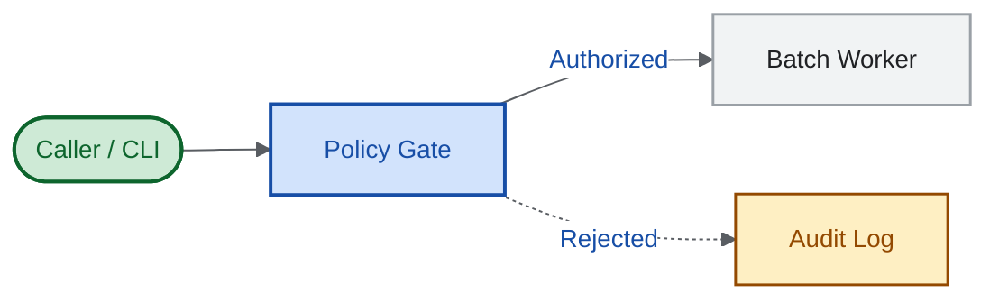

# Google Docs Native Markdown (`.md`) Dialect, Figures & Drive Assets

Reference for authoring, compiling, and uploading native Markdown (`.md`, `mimeType: text/markdown`) deliverables opened in Google Docs Editor (`https://docs.google.com/document/d/<FILE_ID>/edit`).

## Supported vs. Unsupported Syntax

| Element                                            | Native Google Docs `.md` Status | Rule / Replacement                                                                                           |
| -------------------------------------------------- | ------------------------------- | ------------------------------------------------------------------------------------------------------------ |
| ATX headings (`#` to `######`)                     | Supported                       | Maps to Google Docs `HEADING_1`–`HEADING_6` and populates the left Document Outline.                         |
| Bold, italic, strikethrough, inline code           | Supported                       | `**bold**`, `*italic*`, `~~strike~~`, and `` `code` `` render natively.                                      |
| Inline & reference links                           | Supported                       | `[text](https://...)` and `[text][ref]` render as clickable Docs links.                                      |
| Nested lists & interactive checklists              | Supported                       | `1.`, `-`, and `- [ ]` / `- [x]` map to native Docs lists and interactive checklists (`BULLET_CHECKBOX`).    |
| GFM pipe tables                                    | Supported                       | Pipe tables with `:---`, `:---:`, `---:` alignment map to native Google Docs tables.                         |
| Fenced code blocks (` ```python `, ` ```text `)    | Supported                       | Map to native Google Docs `codeBlock` elements with syntax highlighting (or monospace box diagrams).         |
| Blockquotes (`> ...`) & horizontal rules (`---`)   | Supported                       | Render natively; always leave a blank line before `---` so it does not trigger a Setext `HEADING_2`.         |
| LaTeX math (`$...$` and `$$...$$`)                 | Supported                       | Parsed into native Google Docs equation nodes.                                                               |
| Footnotes (`[^1]` and `[^1]: ...`)                 | Supported                       | Parsed into native Google Docs footnotes at the page bottom.                                                 |
| Reference-style Base64 PNG (`![alt][id]`)          | Supported                       | `[fig-N]: <data:image/png;base64,...>` at file bottom renders as a native `inlineObjectElement` image.       |
| Drive comments, revisions & AST read-back          | Supported                       | Anchored `drive.comments` (`doco.*`) survive `drive.files.update --upload`; inspect via `documents.get`.     |
| YAML frontmatter (`--- ... ---`)                   | Unsupported                     | Closing `---` triggers Setext `HEADING_2`. Use top metadata lines or a bold subtitle below `# Title`.        |
| Setext underlines (`---` directly under text)      | Unsupported pitfall             | Turns the preceding paragraph into `HEADING_2`. Put a blank line before `---` or use `## Heading`.           |
| GitHub alerts (`> [!IMPORTANT]`)                   | Unsupported                     | Tag token renders literally. Use a bold blockquote (`> **Important — Decision needed:** ...`).               |
| Raw HTML (`<details>`, `<summary>`, `<u>`, `<br>`) | Unsupported                     | Tags render literally. Use standard `## Annex` headings, Markdown emphasis, and `\` hard line breaks.        |
| Fenced ` ```mermaid ` blocks                       | Unsupported raw                 | Render as literal code blocks unless compiled to `@2x` PNG references by `scripts/compile_markdown_doc.py`.  |
| Inline or linked `.svg` (`data:image/svg+xml`)     | Unsupported raw                 | Ignored by Docs parser unless rasterized to `@2x` PNG references by `scripts/compile_markdown_doc.py`.       |
| Multi-tab Document Tabs & `batchUpdate`            | Unsupported in `.md`            | Native `.md` is single-tab (`tabs[0]`). Use `.gdoc` (`application/vnd.google-apps.document`) when requested. |

## Reference-Style Base64 PNG & Drive `assets/` Architecture

Embedding Base64 data URIs inline (``) pollutes the Markdown body with multi-kilobyte lines. Instead, [`scripts/compile_markdown_doc.py`](../scripts/compile_markdown_doc.py) compiles every fenced ` ```mermaid ` block and local `` image into a short reference in the body, appends the Base64 definitions at the bottom of the `.md` file, and exports all editable sources into `--assets-dir`:

```markdown
![Figure 1 — Nightly batch execution flow on spot virtual machines][fig-1]

_Figure 1. Automatic retries keep reclaimed spot machines within the 07:00 window._

[fig-1]: data:image/png;base64,iVBORw0KGgoAAAANSUhEUgAA...
```

When `compile_markdown_doc.py` compiles a fenced ` ```mermaid ` block, it resolves the image alt text in this order:

1. An explicit `%% alt: <description>` comment inside the Mermaid block.
1. An italic caption line (`_Figure 1. ..._` or `*Figure 1. ...*`) immediately following the fenced block.
1. A default `Figure N — Architecture diagram` fallback.

### Uploading Editable Assets to Google Drive (`assets/<doc-slug>/`)

Keep the parent Drive folder clean for readers while preserving editable diagram sources on Drive right next to the document:

1. Pass `--drive-folder "<FOLDER_ID>"` (and optional `--file-id "<FILE_ID>"`, `--doc-name "<Title>.md"`, `--doc-slug "<doc-slug>"`) to `compile_markdown_doc.py`:
   - Exports `<doc-slug>.src.md`, extracted `fig-N.mmd` Mermaid sources, validated `<name>.svg` vector figures, and `@2x` `fig-N.png` rasters into `--assets-dir` (defaulting to `assets/<doc-slug>/` next to `--output`).
   - Upserts `<Title>.md` (`mimeType: text/markdown`) in `<FOLDER_ID>` (or updates `<FILE_ID>` in place, preserving its URL, revision history, and open Docs comments).
   - Creates or reuses `assets/<doc-slug>/` inside `<FOLDER_ID>` and upserts every exported source and PNG file via `gws drive files`.
   - Returns `drive.docs_url`, `drive.assets_folder_url`, and `drive.uploaded_assets` in the JSON output.

## Branding and Mermaid Styling

Apply `~/.agents/DESIGN.md` (Fmind Theme) by default, or the customer's brand guide when available:

| Role                   | `~/.agents/DESIGN.md` (Fmind Theme)                           | Customer Branding (when available)                                           |
| ---------------------- | ------------------------------------------------------------- | ---------------------------------------------------------------------------- |
| Canvas background      | `#FFFFFF`                                                     | `#FFFFFF` (always keep an opaque light canvas for Google Docs compatibility) |
| Secondary panel / card | `#F1F3F4`                                                     | Customer light neutral surface (or `#F8F9FA` fallback)                       |
| Structural border      | `#9AA0A6` (`#DADCE0` subtle divider)                          | Customer neutral border token                                                |
| Primary ink / muted    | `#202124` / `#595D62`                                         | Customer primary dark text / secondary muted ink                             |
| Primary accent / fill  | `#174EA6` stroke / `#D2E3FC` fill                             | Customer primary brand accent / light brand tint surface                     |
| Semantic status pairs  | `#0D652D`/`#CEEAD6`, `#934900`/`#FEEFC3`, `#A50E0E`/`#FAD2CF` | Customer semantic status tokens (or accessible WCAG AA pairs)                |
| Typography             | `Google Sans`, `Google Sans Code`                             | Customer heading/body font and monospace font (with web-safe fallbacks)      |

Never invent customer brand colors or mix Fmind and customer palettes in the same document; ask for the customer's brand guide when missing. Configure Mermaid via YAML frontmatter (never `%%{init: ...}%%`):



## Standalone SVG Figure Contract (960px Canvas)

Follow [diagrams-as-code SVG rules](../../diagrams-as-code/references/svg/GUIDE.md) for custom KPI cards, architecture diagrams, and comparison visuals linked from `.src.md`:

1. **Root attributes**: `xmlns="http://www.w3.org/2000/svg"`, `viewBox="0 0 960 H"`, `role="img"`, and `aria-labelledby="title desc"` pointing to non-empty `<title id="title">` and `<desc id="desc">` children.
1. **Canvas background**: start with `<rect width="960" height="H" rx="16" fill="#FFFFFF"/>` so dark-mode viewers never invert dark text against a transparent backdrop.
1. **Typography and security**: keep every `font-size >= 12px` (`12px` labels, `14px` body, `18–24px` titles); never include `<script>`, `<foreignObject>`, event attributes (`onload`), or external URLs (`@import`, remote images).
1. **Rasterization**: `compile_markdown_doc.py` parses `viewBox="0 0 W H"` and invokes isolated headless Chrome (`--window-size=W,H --force-device-scale-factor=2 --default-background-color=00000000`, JavaScript and network disabled) to produce a crisp `2W × 2H` PNG without clipping or whitespace.

## `.gdoc` Exception (When Requested or Multi-Tab)

When the user asks to use `.gdoc` format (`application/vnd.google-apps.document`) or when a document requires multiple **Document Tabs**, create or update it through `gws docs documents` (`batchUpdate`) and extract tab structure with [`~/.agents/skills/gws/scripts/docs_text.py`](../../gws/scripts/docs_text.py) as documented in [Workspace content recipes](../../gws/references/services.md#docs).

## Official Google Documentation

- [Google Developers Blog: Preview, edit, and collaborate on Markdown (.md) files natively in Google Docs and Drive](https://developers.googleblog.com/preview-edit-and-collaborate-on-markdown-md-files-natively-in-google-docs-and-drive/)
- [Google Docs Help: Use Markdown in Google Docs, Slides, & Drawings](https://support.google.com/docs/answer/12014036)
- [Google Workspace Updates: Import and export Markdown in Google Docs](https://workspaceupdates.googleblog.com/2024/07/import-and-export-markdown-in-google-docs.html)
- [Google Drive API: Manage file uploads](https://developers.google.com/workspace/drive/api/guides/manage-uploads)
