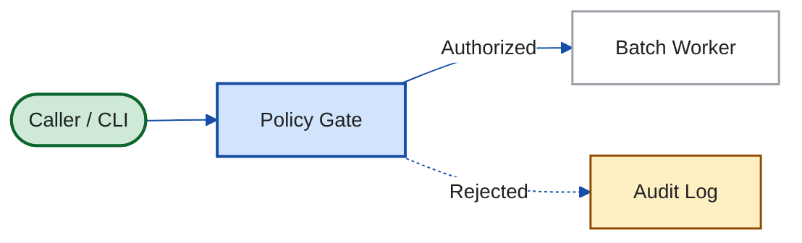

# Google Docs Native Markdown (`.md`) Dialect & Figures

Reference for authoring and compiling native Markdown (`.md`, `mimeType: text/markdown`) deliverables opened in Google Docs Editor (`https://docs.google.com/document/d/<FILE_ID>/edit`).

## Supported vs. Unsupported Syntax

| Element                                        | Native Google Docs `.md` Status | Rule / Replacement                                                                                          |
| ---------------------------------------------- | ------------------------------- | ----------------------------------------------------------------------------------------------------------- |
| ATX headings (`#` to `######`)                 | Supported                       | Maps to Google Docs `HEADING_1`–`HEADING_6` and populates the left Document Outline.                        |
| Bold, italic, strikethrough, inline code       | Supported                       | `**bold**`, `*italic*`, `~~strike~~`, and `` `code` `` render natively.                                     |
| Inline & reference links                       | Supported                       | `[text](https://...)` and `[text][ref]` render as clickable Docs links.                                     |
| GFM tables                                     | Supported                       | Pipe tables with `:---`, `:---:`, `---:` alignment map to native Google Docs tables.                        |
| Interactive checklists (`- [ ]`, `- [x]`)      | Supported                       | Map to interactive Google Docs checklists (`BULLET_CHECKBOX`).                                              |
| Fenced code blocks (` ```python `)             | Supported                       | Map to native Google Docs `codeBlock` elements with syntax highlighting.                                    |
| LaTeX math (`$...$` and `$$...$$`)             | Supported                       | Parsed into native Google Docs equation nodes.                                                              |
| Footnotes (`[^1]` and `[^1]: ...`)             | Supported                       | Parsed into native Google Docs footnotes at the page bottom.                                                |
| Reference-style Base64 PNG (`![alt][id]`)      | Supported                       | `[fig-N]: <data:image/png;base64,...>` at file bottom renders as a native `inlineObjectElement` image.      |
| YAML frontmatter (`--- ... ---`)               | Unsupported                     | Closing `---` triggers Setext `HEADING_2`. Use top metadata lines or a bold subtitle below `# Title`.       |
| GitHub alerts (`> [!IMPORTANT]`)               | Unsupported                     | Tag text renders literally. Use a bold blockquote (`> **Important — Decision needed:** ...`).               |
| Raw HTML (`<details>`, `<summary>`, `<u>`)     | Unsupported                     | Tags render literally. Use standard `## Annex` headings and Markdown emphasis.                              |
| Fenced ` ```mermaid ` blocks                   | Unsupported raw                 | Render as literal code blocks unless compiled to `@2x` PNG references by `scripts/compile_markdown_doc.py`. |
| Inline or linked `.svg` (`data:image/svg+xml`) | Unsupported raw                 | Ignored by Docs parser unless rasterized to `@2x` PNG references by `scripts/compile_markdown_doc.py`.      |
| Multi-tab Document Tabs                        | Unsupported in `.md`            | Native `.md` is single-tab (`tabs[0]`). Use `application/vnd.google-apps.document` when tabs are required.  |

## Reference-Style Base64 PNG Architecture

Embedding Base64 data URIs inline (``) pollutes the Markdown body with multi-kilobyte lines. Instead, [`scripts/compile_markdown_doc.py`](../scripts/compile_markdown_doc.py) compiles every fenced ` ```mermaid ` block and local `` image into a clean reference in the body and appends the Base64 definitions at the very bottom of the `.md` file:

```markdown
![Figure 1 — Nightly batch execution flow on spot virtual machines][fig-1]

_Figure 1. Automatic retries keep reclaimed spot machines within the 07:00 window._

[fig-1]: data:image/png;base64,iVBORw0KGgoAAAANSUhEUgAA...
```

When `compile_markdown_doc.py` compiles a fenced ` ```mermaid ` block, it resolves the image alt text in this order:

1. An explicit `%% alt: <description>` comment inside the Mermaid block.
1. An italic caption line (`_Figure 1. ..._` or `*Figure 1. ...*`) immediately following the fenced block.
1. A default `Figure N — Architecture diagram` fallback.

## Mermaid Styling (`~/.agents/DESIGN.md`)

For Fmind work, style Mermaid diagrams with the light palette from `~/.agents/DESIGN.md` (`#FFFFFF` canvas, `#F1F3F4` panel, `#174EA6` primary blue, `#202124` charcoal text, and `edgeLabelBackground: "#FFFFFF"` so edge labels never sit on dark boxes). For client work, substitute the client's brand colors.



## Standalone SVG Figure Contract (960px Canvas)

Follow [diagrams-as-code SVG rules](../../diagrams-as-code/references/svg/GUIDE.md) for custom KPI cards, architecture diagrams, and comparison visuals linked from `.src.md`:

1. **Root attributes**: `xmlns="http://www.w3.org/2000/svg"`, `viewBox="0 0 960 H"`, `role="img"`, and `aria-labelledby="title desc"` pointing to non-empty `<title id="title">` and `<desc id="desc">` children.
1. **Canvas background**: start with `<rect width="960" height="H" rx="16" fill="#FFFFFF"/>` so dark-mode viewers never invert dark text against a transparent backdrop.
1. **Typography and security**: keep every `font-size >= 12px` (`12px` labels, `14px` body, `18–24px` titles); never include `<script>`, `<foreignObject>`, event attributes (`onload`), or external URLs (`@import`, remote images).
1. **Rasterization**: `compile_markdown_doc.py` parses `viewBox="0 0 W H"` and invokes headless Chrome with `--window-size=W,H --force-device-scale-factor=2 --default-background-color=00000000` (and JavaScript + network disabled) to produce a crisp `2W × 2H` PNG without clipping or whitespace.

## Multi-Tab `.gdoc` Exception

When a document requires multiple **Document Tabs** (`application/vnd.google-apps.document`), create or update it through `gws docs documents` (`batchUpdate`) and extract tab structure with [`~/.agents/skills/gws/scripts/docs_text.py`](../../gws/scripts/docs_text.py) as documented in [Workspace content recipes](../../gws/references/services.md#docs).
