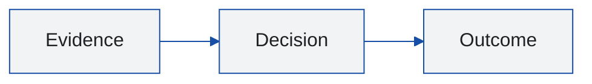

# Fmind Design in Renderers

`~/.agents/DESIGN.md` owns the Fmind tokens, roles, components, and rules; its source is [fmind/theme DESIGN.md](https://github.com/fmind/theme/blob/main/DESIGN.md). Read it first. Renderers then take a ready-made file from the same pinned fmind/theme revision, so no template here carries palette values.

## Pinned files

fmind/dot deploys these files to `~/.agents/themes/` beside DESIGN.md ([sources and installation notes](https://github.com/fmind/theme/tree/main/themes)). Copy the file into the project that renders with it and keep it unchanged; change the design in fmind/theme, never in a copy.

- **`css/fmind.css`**: CSS custom properties (`--fmind-color-*`, `--fmind-spacing-*`, `--fmind-rounded-*`) for plain pages and rendered HTML.
- **`tailwind/fmind.css`**: a Tailwind CSS v4 `@theme` block with the DESIGN.md token names (`bg-canvas`, `text-primary`, `max-w-reading-width`); import it after `tailwindcss`.
- **`daisyui/fmind.css`**: a daisyUI 5 theme; import it after the plugin with `themes: false`.
- **`zensical/fmind.css`**: the light scheme of a Zensical or Material for MkDocs site, including syntax colors.
- **`d2/fmind.d2`**: theme overrides and the `diagram-*` classes.
- **`mermaid/fmind.json`**: a Mermaid `base` theme configuration.
- **`vhs/fmind.tape`**: the terminal palette for VHS recordings.

For Figma variables or Style Dictionary, export W3C Design Tokens; the format is alpha, so pin the CLI version and review the output:

```bash
npx @google/design.md@0.4.0 export --format dtcg ~/.agents/DESIGN.md
```

## Mermaid

Render with the pinned configuration: `mmdc --configFile ~/.agents/themes/mermaid/fmind.json --input diagram.mmd --output diagram.svg`. It customizes Mermaid's `base` theme, the only customizable one, and sets the classic look.

A renderer that reads only the Mermaid source, such as GitHub Markdown, needs frontmatter instead. Copy `theme` and the `themeVariables` the diagram uses from the pinned file; these four cover a flowchart. `layout: dagre` and `look: classic` follow the diagrams-as-code rule to [pin the layout and look](../../diagrams-as-code/references/mermaid.md#gotchas), so Mermaid 11 and 12 renderers draw the same diagram.



Load Google Sans before rendering, as the [renderer-stable font stack](../../diagrams-as-code/references/mermaid.md#gotchas) rule requires.

## SVG Illustrations

README and user-doc illustrations copy [illustration.svg](../../diagrams-as-code/references/svg/templates/illustration.svg). Its `<style>` maps DESIGN.md roles to classes: `chip` (panel items), `box` (primary-bordered system boundary), `tile` (selection fill, primary code title), `config` (warning surface), `err` (error surface), `step`, `flow`, and `arrowhead` (primary badges and arrows), `mask` (canvas behind captions), and `label` and `muted` (secondary text). The outer card stays white with a light `#DADCE0` border so the art reads on dark README themes. For a customer brand, swap these values and font names only.

## D2

Copy `~/.agents/themes/d2/fmind.d2` beside the diagram sources and spread-import it on the first line (`...@fmind`). It sets D2 theme overrides, a white canvas, and dark blue connections, and implements the DESIGN.md `diagram-*` components as classes (`group`, `container`, `component`, `actor`, `external`, `step`, `terminal`). Fmind diagrams use these classes instead of declaring colors.

For another brand, start from a built-in D2 theme and use `theme-overrides` under `vars.d2-config`. [Supply all eight `--font-*` flags](../../diagrams-as-code/references/d2.md#gotchas) from static TTF faces: Google Sans for `--font-regular`, `--font-italic`, `--font-semibold`, and `--font-bold`; Google Sans Code for `--font-mono`, `--font-mono-italic`, `--font-mono-semibold`, and `--font-mono-bold`. Instantiate variable fonts at the intended weights before assigning them to these slots; one variable font reused for every slot can render every weight as regular.
