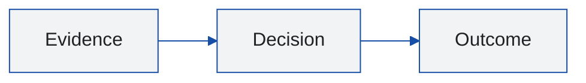

# Fmind Design in Renderers

Read `~/.agents/DESIGN.md` ([fmind/theme DESIGN.md](https://github.com/fmind/theme/blob/main/DESIGN.md)) first, then copy the matching renderer file below without editing it (modify upstream `fmind/theme` instead).

## Pinned files

Deployed to `~/.agents/themes/` ([upstream themes](https://github.com/fmind/theme/tree/main/themes)):

- **`css/fmind.css`**: `--fmind-color-*`, `--fmind-spacing-*`, and `--fmind-rounded-*` custom properties.
- **`tailwind/fmind.css`**: Tailwind CSS v4 `@theme` tokens (`bg-canvas`, `text-primary`, `max-w-reading-width`), imported after `tailwindcss`.
- **`daisyui/fmind.css`**: daisyUI 5 theme, imported after the plugin with `themes: false`.
- **`zensical/fmind.css`**: Zensical / Material for MkDocs light scheme + syntax palette.
- **`d2/fmind.d2`**: D2 theme overrides and `diagram-*` classes.
- **`mermaid/fmind.json`**: Mermaid `base` theme config.
- **`vhs/fmind.tape`**: VHS terminal palette.

Export alpha W3C Design Tokens for Figma or Style Dictionary via a pinned CLI:

```bash
npx @google/design.md@0.4.0 export --format dtcg ~/.agents/DESIGN.md
```

## Mermaid

CLI render: `mmdc --configFile ~/.agents/themes/mermaid/fmind.json --input diagram.mmd --output diagram.svg` (uses `base`, Mermaid's only customizable theme, with `classic` look and preloaded Google Sans per the [font-stack rule](../../diagrams-as-code/references/mermaid.md#gotchas)). For inline Markdown renderers (such as GitHub), embed `theme`, used `themeVariables`, and [pinned `dagre`/`classic`](../../diagrams-as-code/references/mermaid.md#gotchas) in frontmatter:



## SVG Illustrations

Copy [illustration.svg](../../diagrams-as-code/references/svg/templates/illustration.svg): its `<style>` maps DESIGN.md roles (`chip`, `box`, `tile`, `config`, `err`, `step`, `flow`, `arrowhead`, `mask`, `label`, `muted`) inside a `#FFFFFF` card with `#DADCE0` border for dark-mode legibility. Swap only hex values and font names for customer brands.

## D2

Copy `~/.agents/themes/d2/fmind.d2` beside sources and start with `...@fmind` to apply DESIGN.md `diagram-*` classes (`group`, `container`, `component`, `actor`, `external`, `step`, `terminal`) without inline colors. For customer brands, override a built-in theme via `vars.d2-config.theme-overrides`. [Supply all eight `--font-*` flags](../../diagrams-as-code/references/d2.md#gotchas) using static instantiated TTF weights—Google Sans (`--font-regular`, `--font-italic`, `--font-semibold`, `--font-bold`) and Google Sans Code (`--font-mono`, `--font-mono-italic`, `--font-mono-semibold`, `--font-mono-bold`)—since reusing one variable font renders every slot as regular.
