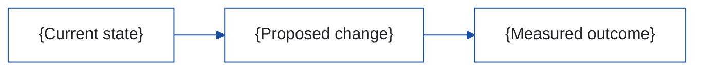

<!--
  Humanized Markdown template for GitHub and Zensical briefs.
  Replace {placeholders}, keep plain prose (zero backticks except copyable commands or paths), and delete unused sections.
  Dialect notes:
  - Google Docs (.md): strip HTML comments and details blocks, replace [!IMPORTANT] with **Decision needed by DATE:**, and compile figures via draft/doc.
  - Zensical docs: replace [!IMPORTANT] with !!! important "Decision needed" and details with ??? info "Methodology and assumptions" (bodies indented 4 spaces), and use ==highlight== around the core metric.
-->

# {Clear title naming the subject}

**{Decision memo}** · Status: {Draft} · Audience: {Reader role} · Date: {Date}

## Executive summary

**Recommend {Option}:** {plain one-sentence core signal and impact.}

{Two sentences of context highlighting the decisive impact against a named baseline, with [inline links to primary sources]({https://primary.source/page}).}

> [!IMPORTANT]
> **Decision needed:** {What the reader should approve or choose, by when.}

## Options compared

**{Option X} leads on {key metric}:** {concise one-sentence comparison trade-off.}

| Option                   | {Monthly impact} | {Main trade-off}  | Status         |
| ------------------------ | ---------------- | ----------------- | -------------- |
| **{Recommended option}** | {Range vs base}  | {Low / mitigated} | 🟢 Recommended |
| {Alternative}            | {Range vs base}  | {Higher effort}   | 🟡 Viable      |
| Do nothing               | {Baseline cost}  | {Growing risk}    | 🔴 Risky       |

## Risks & next steps

**Top risk:** {risk}, mitigated by {control}; revisit only if {flip condition}.

- [ ] **{First action}**: {Owner}, by {Date}.
- [ ] **{Follow-up action}**: {Owner}, by {Date}.

---

## Sources

- [{Primary source title}]({https://primary.source/page}) ({date or version}): grounds {the baseline metric or architectural constraint}.

Methodology and assumptions

- **Method**: {Formula, sample size, and sensitivity range.}

