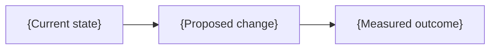

<!--
  Humanized Markdown template for GitHub and Zensical briefs.
  Replace {placeholders}, keep plain prose (zero backticks except copyable commands or paths), and delete unused sections.
  Dialect notes:
  - Google Docs (.md): replace [!IMPORTANT] with **Decision needed by DATE:** and compile Typst figures via draft-doc.
  - Zensical docs: replace [!IMPORTANT] with `!!! important "Decision needed"`, and use ==highlight== around the core metric.
-->

# {Clear title naming the subject}

**{Decision memo}** · Status: {Draft} · Audience: {Reader role} · Date: {Date}

---

## Executive summary

**{Core signal and recommendation in one plain sentence.}**

{Two sentences of context highlighting the decisive impact against a named baseline, with [inline links to primary sources]({https://primary.source/page}).}

> [!IMPORTANT]
> **Decision needed:** {What the reader should approve or choose, by when.}

---

## Options compared

**{One-sentence comparison conclusion.}**

| Option                   | {Monthly impact} | {Main trade-off}  | Status         |
| ------------------------ | ---------------- | ----------------- | -------------- |
| **{Recommended option}** | {Range vs base}  | {Low / mitigated} | 🟢 Recommended |
| {Alternative}            | {Range vs base}  | {Higher effort}   | 🟡 Viable      |
| Do nothing               | {Baseline cost}  | {Growing risk}    | 🔴 Risky       |

---

## Risks & next steps

**{Choose option X because of the clear margin in speed and reliability.}** Top risk is {risk}, mitigated by {control}; we would revisit only if {flip condition}.

- [ ] **{First action}** — {Owner}, by {Date}.
- [ ] **{Follow-up action}** — {Owner}, by {Date}.

Supporting visual, method, and sources

- **Method**: {Formula, inputs, and uncertainty range.}
- **Sources**: [{Primary source}]({https://primary.source/page}), checked {date}.

