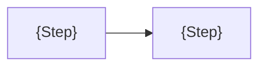

<!--
  Markdown template for formal documents: a one-page decision memo or proposal with annexes; analyses replace Options and
  Recommendation with one section per finding. Emails, status updates, and teammate documents do not use it.
  Replace every {placeholder}, keep the user's option labels, write in the reader's language, and delete sections that do not apply.
  Adapt the syntax to the destination's renderer:
  - Google Docs native Markdown (.md via draft-doc, for living docs): no YAML frontmatter (---), use a bold
    blockquote (`> **Important — Decision needed:** ...`) instead of `> [!IMPORTANT]`, use standard `## Annex`
    headings instead of `<details>`, and compile fenced ```mermaid blocks and .svg links into Base64 PNG reference
    definitions (`[fig-N]: <data:image/png;base64,...>`) with `draft-doc/scripts/compile_markdown_doc.py`.
  - GitHub and Zensical: `> [!IMPORTANT]` alerts render on GitHub and on Zensical with gh-admonitions
    (Zensical prefers `!!!` admonitions); `<details>` and fenced Mermaid blocks work natively.
  Delete this comment before sharing.
-->

# {Simple title that names the subject, such as: Comparing the cost of A and B}

Type: {Decision memo}\
Status: {Draft}\
Audience: {Audience and role}\
Author: {Author}\
Date: {Date}\
Data as of: {Price or data date}

## Executive summary

**{Take-home message in one sentence.}**

{Context in one or two sentences and why it matters to this reader, with the key figure in bold, its unit, period, and baseline, and [inline links to sources]({https://primary.source/page}).}

> [!IMPORTANT]
> **Decision needed:** {What the reader should decide or do, and by when.}

## Options

**{Conclusion of the comparison in one sentence.}**

| Option                                     | {Criterion, such as cost} | {Criterion, such as main risk} | {Criterion, such as time to value} |
| ------------------------------------------ | ------------------------- | ------------------------------ | ---------------------------------- |
| {Option A}: {Alternative}                  | {…}                       | {…}                            | {…}                                |
| **{Option B}: {Recommended}**, recommended | {…}                       | {…}                            | {…}                                |
| {Option C}: {Do nothing}                   | {…}                       | {…}                            | {…}                                |

## Recommendation and risks

**{Choose option X, and why, in one sentence.}** {Main risks with their mitigations, and what would change the recommendation, in a few sentences.}

## Next steps

- [ ] {Action}: {Owner}, by {Date}.

## Annexes

<details>
<summary>Annex A. Key terms</summary>

- **{Term or unit}**: {What it means in plain words; for a metric, its unit and which direction is better.}

</details>

<details>
<summary>Annex B. Diagram</summary>



_Figure 1. {Caption that states the conclusion of the figure.} Source: [{Source}]({https://source/page}), {date}._

</details>

<details>
<summary>Annex C. Method and assumptions</summary>

{How each figure was computed: formula, inputs, and the range of each uncertain input.}

</details>

<details>
<summary>Annex D. Sources</summary>

1. [{Source title}]({https://primary.source/page}), retrieved {date}.

</details>
