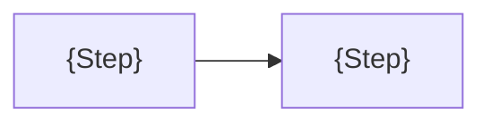

<!--
  Markdown report template for busy readers: decision memos, analyses, and status reports.
  Replace every {placeholder}, write in the reader's language, and delete sections that do not apply.
  Adapt the syntax to the destination's renderer: `> [!IMPORTANT]` alerts render on GitHub and on Zensical
  with gh-admonitions, Zensical prefers `!!!` admonitions, and other renderers show a plain quote.
  `
` and Mermaid work on GitHub and Zensical; elsewhere, use a heading and an image instead.
  Delete this comment before sharing.
-->

# {Title that names the subject, such as: Comparing the cost of A and B}

Type: {Decision memo}\
Status: {Draft}\
Audience: {Audience and role}\
Author: {Author}\
Date: {Date}\
Data as of: {Price or data date}

## Executive summary

**{Take-home message in one sentence.}**

{Why it matters to this reader, with the one or two key figures in bold, each with unit, period, and baseline.}

> [!IMPORTANT]
> **Decision needed:** {What the reader should decide or do, and by when.}

## Key terms

- **{Term or unit}**: {What it means in plain words; for a metric, its unit and which direction is better.}

## Context

**{Conclusion of the section in one sentence.}** {Explanation in plain words, with a concrete example and [inline links to sources]({https://primary.source/page}).}

> **Take-home messages**: {Long sections only: what this section means for the reader's decision.}

## Options

**{Conclusion of the comparison in one sentence.}**

| Option                                          | {Cost} | {Risk}           | {Time to value} |
| ----------------------------------------------- | ------ | ---------------- | --------------- |
| Option 1: {Do nothing}                          | {…}    | 🟡 {Medium}: {…} | {…}             |
| **Option 2: {Recommended option}**, recommended | {…}    | 🟢 {Low}: {…}    | {…}             |
| Option 3: {Alternative}                         | {…}    | 🔴 {High}: {…}   | {…}             |

_Figure 1. {Caption that states the conclusion of the figure.} Source: [{Source}]({https://source/page}), {date}._

## Recommendation

**{Choose Option N, and why, in one sentence.}** {Assumptions, residual risks, and what would change the recommendation.}

## Next steps

- [ ] {Action}: {Owner}, by {Date}.

## Annexes

Annex A. Method and assumptions

{How each figure was computed: formula, inputs, and the range of each uncertain input.}

Annex B. Sources

1. [{Source title}]({https://primary.source/page}), retrieved {date}.

